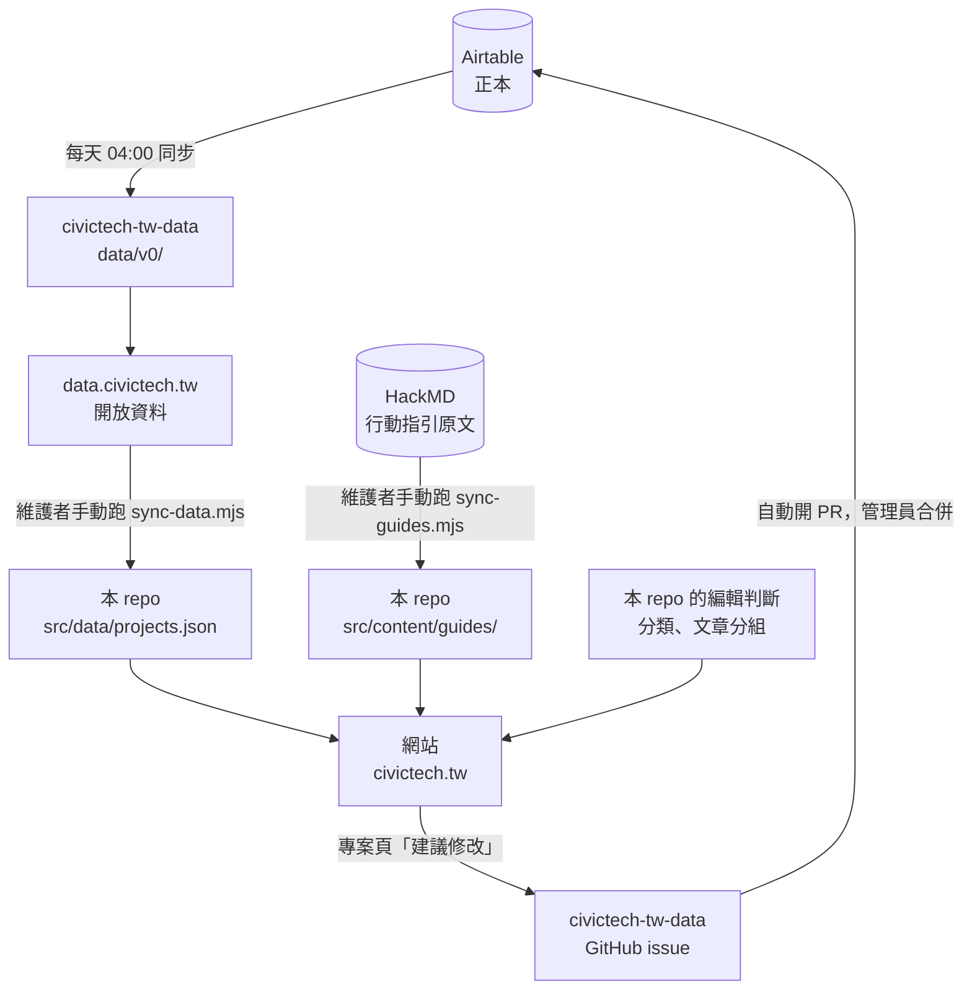

# 資料怎麼流動、介紹怎麼產生、怎麼一起來改

這份文件寫的是**現在實際怎麼運作**，不是理想上該怎麼運作。還沒做到的地方會直接寫出來。

civictech.tw 由兩個 repo 組成：

- [**g0v/civictech-tw-data**](https://github.com/g0v/civictech-tw-data)：把資料庫匯出成開放資料（[data.civictech.tw](https://data.civictech.tw)），也是收修改申請的地方
- **本 repo**：用那份開放資料蓋出 civictech.tw 網站

## 一、資料怎麼流動



### 哪一層是正本

| 資料 | 正本在哪 | 其餘都是衍生品 |
| :--- | :--- | :--- |
| 專案（名稱、簡介、連結、AI 介紹） | **Airtable** | `data.civictech.tw`、本 repo 的 `projects.json`、網頁 |
| 行動指引文章 | **[g0v HackMD](https://g0v.hackmd.io/@jothon/guide)** | 本 repo 的 `src/content/guides/`、網頁 |
| 專案分類、文章分組 | **本 repo**（`src/data/classification.ts`、`categories.ts`、`guideGroups.ts`） | 網頁 |

改衍生品沒有用，下次同步就會被蓋掉。要改什麼，就去改它的正本。

### 跟直覺不一樣的地方

- **網站不會自己更新。** `data.civictech.tw` 每天同步，但網站用的是 commit 進 repo 的快照，要有人跑 `node scripts/sync-data.mjs` 再 commit。這是刻意的：每次資料變動都是一顆看得到差異的 commit。
- **分類不在 Airtable 裡，也不在開放資料裡。** 站上的十七個議題分類是這個網站自己的編輯判斷，照 2026-07 公民科技需求問卷的議題領域切。專案怎麼歸類：先看人工覆蓋清單（`classification.ts` 的 `overrides`），沒有就取 Airtable 上**第一個**影響力類別對應過去。
- **行動指引文章不在開放資料裡。** 只存在網站上。
- **有兩個正本。** 專案在 Airtable，文章在 HackMD。

### 已知會出錯的地方

會安靜出錯的（沒有任何地方會提醒）：

1. **新專案會被預設規則分類，可能分錯。** 預設規則只看影響力類別，比問卷的分法粗。目前大約三分之一的專案是靠人工覆蓋才分對的；新專案沒有人工覆蓋。
2. **一個專案標了多個影響力類別時，只取第一個。** 順序是 Airtable 決定的，沒有人判斷過。
3. **HackMD 原文改了，網站不會知道。** 要有人重跑同步。

會擋住部署的（刻意讓它失敗）：

4. **專案在 Airtable 改名，覆蓋清單就對不上，build 會失敗。** 跑同步的人要先修好覆蓋清單。
5. **同步進一篇新文章卻沒有分組，build 會失敗**，並指出是哪一篇。

## 二、專案介紹（AI insight）怎麼產生

每個專案頁上的四行介紹，是 AI 讀過這個專案的公開素材後寫的。它同時放在專案頁和開放資料的 `AI insight` 欄位。

### 為什麼是固定四行

```
做什麼：（25 字以內）
給誰、解決什麼：（40 字以內）
怎麼運作：（40 字以內）
討論在哪裡：（40 字以內）
```

它有兩種讀者：第一次接觸公民科技的人，以及被使用者整包餵進去的 AI。後者會偏重字數多的專案。原本的簡介欄位裡，字數最多的一成專案佔了全部文字的一半。所以每則介紹的結構、順序、長度都要差不多。素材裡找不到的就寫「不明」。

### 三個步驟，刻意分開

所有工具都在 [civictech-tw-data 的 `scripts/`](https://github.com/g0v/civictech-tw-data/tree/main/scripts)。

1. **採集**：`python3 scripts/insight-harvest.py <專案名稱>` 會把這個專案的 repo、官網、共筆、HackMD、Slack 封存收成一份素材包，每段都附出處和取得日期。拿不到的會明寫「抓不到」，看起來不屬於這個專案的會標 ⚠️。
2. **產生**：把 [`scripts/insight-prompt.md`](https://github.com/g0v/civictech-tw-data/blob/main/scripts/insight-prompt.md) 裡的提示詞整段複製到任何一個 AI，最後貼上素材包。**提示詞可以直接複製使用**，每一條鐵則為什麼存在也寫在同一個檔案裡。
3. **檢查**：`python3 scripts/insight-check.py insights.jsonl` 用程式逐行數字數、抓評價性用語。字數不能靠 AI 自律。

程式檢查通過之後，**還要有人對著來源看一次**。不是審文筆，是擋掉 AI 自己補上的東西。

採集要連網、要判斷素材可不可信，所以只能由腳本做；產生只吃素材包，誰都能跑、用哪個 AI 都行。分開是為了讓第二步可以交給任何人。

### 為什麼每則都標來源與產生日期

開放資料裡的 `AI insight sources` 列出實際用到的網址，`AI insight generated` 是產生日期。沒有出處的 AI 摘要無法查證；沒有日期，讀的人就分不出它是不是舊的。

### 介紹裡刻意不寫的

- **活不活躍、最後更新時間。** 這種資料很快就過期，寫進文字就會跟著變舊。試寫時也發現 AI 判斷「停擺」常常判錯。
- **評價**（重要的、創新的、成功的）。只寫做什麼、為誰做、怎麼做、在哪裡討論。

## 三、怎麼一起來改

### 修改既有專案的資料

在專案頁按「**建議修改**」（或「幫它補一句話」），填你要改的欄位就好。

送出後的流程：

1. 表單會在 civictech-tw-data 開一張 GitHub issue
2. 自動轉成一份修改申請（`edits/issue-編號.json`）並開 PR
3. 管理員看過後合併，自動寫回 Airtable
4. 隔天的同步把它帶回開放資料；網站要等維護者下一次同步才會更新

寫回前會比對 Airtable 現在的值。如果在你送出之後有人改過同一筆，整份申請就不會寫入，PR 上會留言說明。

細節見 civictech-tw-data 的 [`edits/README.md`](https://github.com/g0v/civictech-tw-data/blob/main/edits/README.md)。

**現在的限制**：

- 需要 GitHub 帳號。沒有的話，寄信到 [g0v-jothon@googlegroups.com](mailto:g0v-jothon@googlegroups.com)，主旨加上［civictech.tw］。
- 表單只能改名稱、英文名稱、簡介、官網、原始碼、專案文件、Facebook。
- **AI 介紹不能從表單改。** 介紹寫錯了，請在 civictech-tw-data [開一張 issue](https://github.com/g0v/civictech-tw-data/issues/new)，附上正確的來源。

### 新增一個專案

**目前沒有表單。** 請在 civictech-tw-data [開一張 issue](https://github.com/g0v/civictech-tw-data/issues/new)，寫上專案名稱、一兩句簡介和連結，由管理員加進 Airtable。

新專案上站後會先套用預設分類，可能分錯（見上面「已知會出錯的地方」第 1 點）。如果你知道它該歸哪一類，請在 issue 裡一起寫。

### 幫忙產生專案介紹

照第二節的三個步驟跑，把通過檢查的結果和素材包開一張 issue 交給我們。**寫回 Airtable 目前由維護者手動做**，還沒有自動流程。

### 不同意某個專案的分類

分類是這個 repo 的編輯判斷，而且還是草稿。直接改 [`src/data/classification.ts`](src/data/classification.ts) 的 `overrides` 那一行、開 PR，或開 issue 討論。

### 行動指引文章有錯

文章的正本在 [g0v HackMD](https://g0v.hackmd.io/@jothon/guide)。請改原文或在原文留言，不要改本 repo 的 `src/content/guides/`，下次同步會被蓋掉。

### 網站本身的錯

開在[本 repo 的 issue](https://github.com/cooldongdong/civictech.tw/issues)。改程式的話，開分支、看過預覽網址再發 PR。
